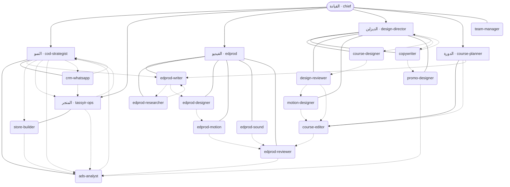

# الإمبراطورية — سجل الوكلاء

> ملف مولَّد — ما تعدّلوش باليد. المصدر: `registry.yaml` · `flows.yaml` · `journal.jsonl` → `python3 .claude/team/team.py table`

كل مهمة عندها **مولى واحد** · كل وكيل يقرا `LESSONS.md` · كل خدمة تتسجل في السجل اليومي مرة وحدة.

## الهيكل

## القيادة — القائد: `chief`

_يستقبل طلب المالك، يوجّهو للمولى، يشغّل التدفقات، ويحرس السجل_

| الوكيل | الدور | يملك | يعطي خدمتو لـ | ما يديرش (مولاها) | تزاد · علاش |
|---|---|---|---|---|---|
| `team-manager` | مسؤول السجل والتوظيف | `team.registry`, `team.hire`, `team.lessons` | — | — | 2026-11-11 · باش ما يكونوش جوج وكلاء يديرو نفس المهمة |

## النمو — القائد: `cod-strategist`

_واش نبيعو، بشحال، وكيفاش نجيبو الزبون ونحافظو عليه_

| الوكيل | الدور | يملك | يعطي خدمتو لـ | ما يديرش (مولاها) | تزاد · علاش |
|---|---|---|---|---|---|
| `cod-strategist` | إستراتيجي المنتج COD (قائد النمو) | `product.cod-strategy`, `product.confirm-script`, `product.scale-cut` | edprod-writer, store-builder, tassyir-ops, ads-analyst, crm-whatsapp | ads.analysis→ads-analyst, video.script→edprod-writer, store.products-stock→tassyir-ops | 2026-11-11 · منتج -> زاوية، عرض، Max CPL، خطة تاست، سكريبت التأكيد، قرار سكايل/قطع |
| `ads-analyst` | محلل إعلانات Meta | `ads.analysis`, `ads.changes` | cod-strategist | product.scale-cut→cod-strategist, video.script→edprod-writer, store.finance-report→tassyir-ops | 2026-11-11 · قراءة الحملات وCPL، وأي تبديل في الإعلانات بموافقة برك |
| `crm-whatsapp` | علاقة الزبائن على واتساب | `crm.messages`, `crm.campaigns`, `crm.abandoned-carts` | tassyir-ops, cod-strategist | product.confirm-script→cod-strategist, store.orders→tassyir-ops | 2026-11-11 · الرسائل اللي تستنى رد، السلات المتروكة، الحملات — بموافقة قبل أي إرسال |

## المتجر — القائد: `tassyir-ops`

_تسيير: الكومندات، الستوك، الصفحات، الأرقام_

| الوكيل | الدور | يملك | يعطي خدمتو لـ | ما يديرش (مولاها) | تزاد · علاش |
|---|---|---|---|---|---|
| `tassyir-ops` | مسيّر تسيير (قائد المتجر) | `store.orders`, `store.products-stock`, `store.finance-report` | cod-strategist, ads-analyst | ads.analysis→ads-analyst, product.cod-strategy→cod-strategist, store.landing-page→store-builder | 2026-11-11 · خدمة يومية على تسيير، يقرا بحرية وما يبدّل والو بلا موافقة |
| `store-builder` | باني صفحات المتجر واللاندينغ | `store.landing-page`, `store.design` | ads-analyst | store.products-stock→tassyir-ops, video.render-motion→edprod-motion | 2026-11-11 · صفحة المنتج هي اللي تبيع: تصميم، أقسام، معاينة، والنشر بموافقة |

## الفيديو — القائد: `edprod`

_فيديوهات الدورة والإعلانات من السكريبت حتى التصدير_

| الوكيل | الدور | يملك | يعطي خدمتو لـ | ما يديرش (مولاها) | تزاد · علاش |
|---|---|---|---|---|---|
| `edprod-writer` | كاتب السكريبت بالدارجة | `video.script`, `video.hook-copy` | edprod-researcher, edprod-designer | video.facts→edprod-researcher, video.render-motion→edprod-motion, product.cod-strategy→cod-strategist | 2026-11-01 · سكريبت لقطة بلقطة قبل أي رندر |
| `edprod-researcher` | مدقّق الحقائق والأرقام | `video.facts` | edprod-writer | video.script→edprod-writer | 2026-11-01 · كل معلومة أو رقم يتأكد قبل ما يطلع في الشاشة |
| `edprod-designer` | المدير الفني: البريف والإحداثيات | `video.visual-brief` | edprod-motion | video.render-motion→edprod-motion | 2026-11-01 · تخطيط كل مشهد بالبيكسل وفحص المنطقة الآمنة |
| `edprod-motion` | مهندس الحركة والرندر | `video.render-motion`, `video.opener`, `video.reel-template` | edprod-reviewer | video.sound→edprod-sound, course.lesson-edit→course-editor, video.qc-export→edprod-reviewer | 2026-11-01 · تحريك البوسترات واللوقوات والافتتاحيات بالكود |
| `edprod-sound` | مصمم الصوت | `video.sound` | edprod-reviewer | course.audio-clean→course-editor | 2026-11-01 · موسيقى ومؤثرات وميكساج -14 LUFS |
| `edprod-reviewer` | المراقب والتصدير | `video.qc-export` | ads-analyst | video.render-motion→edprod-motion | 2026-11-01 · ما يخرج حتى فيديو بلا فحص |

## الديزاين — القائد: `design-director`

_سلايدات الماتش 16:9، العناوين والكلمات، وحركات السلايدات (ecommanita-design-kit) — أمر «درس XX»_

| الوكيل | الدور | يملك | يعطي خدمتو لـ | ما يديرش (مولاها) | تزاد · علاش |
|---|---|---|---|---|---|
| `design-director` | مخرج الديزاين: lesson-XX.json من course-sync (قائد الديزاين) | `design.lesson-json` | copywriter, course-designer | course.curriculum→course-planner, design.lesson-slides→course-designer | 2026-10-30 · كل درس يتحول لـ 3 حتى 6 أفكار = لاعبين، من course-sync بلا اختراع |
| `copywriter` | الكوبيرايتر: الاسم، العناوين، الشعارات، الكابشن | `copy.titles`, `copy.captions` | design-director, promo-designer | video.script→edprod-writer, video.hook-copy→edprod-writer, design.lesson-json→design-director | 2026-10-30 · الكلمة اللي تخلي الواحد يحس بالماتش — 3 حتى 5 خيارات والمدرّب يختار |
| `course-designer` | مخرّج سلايدات الدرس (match_slide.py) | `design.lesson-slides` | design-reviewer | design.slides-qc→design-reviewer, course.lesson-edit→course-editor | 2026-10-30 · JSON مصادق ← سلايدات 16:9 على القالب، بلا ما يعاود يرسم الماركة |
| `design-reviewer` | بوابة السلايدات PASS/FAIL | `design.slides-qc` | motion-designer, course-editor | video.qc-export→edprod-reviewer | 2026-10-30 · حتى سلايد ما يخرج بلا ما يفوت على البوابة والعين |
| `motion-designer` | موشن السلايدات: الحركات الخمسة | `design.slide-motion` | course-editor | video.render-motion→edprod-motion, video.opener→edprod-motion | 2026-10-30 · يحرّك السلايدات المصادقة: الصواعق، الشرارة، التمريرة، كرطة الحدث، الستائر |
| `promo-designer` | الترويج الثابت: بوستر 4:5، كاروسال، ستوري | `design.promo-static` | ads-analyst | video.render-motion→edprod-motion, video.reel-template→edprod-motion, copy.titles→copywriter | 2026-10-30 · نقطة القوة تاع الدرس في بوستر، بالقالب برك |

## الدورة — القائد: `course-planner`

_محتوى الدورة ecommanita وتركيب الدروس من التسجيلات الحقيقية_

| الوكيل | الدور | يملك | يعطي خدمتو لـ | ما يديرش (مولاها) | تزاد · علاش |
|---|---|---|---|---|---|
| `course-planner` | مخطط محتوى الدورة (قائد الدورة) | `course.curriculum`, `course.lesson-outline` | course-editor, edprod-writer | video.script→edprod-writer, course.lesson-edit→course-editor | 2026-11-11 · واش يتقرا في كل درس، بأي ترتيب، وواش يتصوّر قبل ما يسجّل المالك |
| `course-editor` | مونتير الدروس: كاميرا + شاشة | `course.lesson-edit`, `course.sync`, `course.audio-clean`, `course.captions` | edprod-reviewer | video.opener→edprod-motion, video.qc-export→edprod-reviewer, course.lesson-outline→course-planner | 2026-11-11 · الدروس تتركب بـ course_layout.py — تسجيلات حقيقية برك، بلا أفتار |

## التدفقات (كيفاش يتربطو)

### `new-product` — منتج جديد من الفكرة حتى الإعلان
يبدا كي: المالك يبعث منتج، صورة، رابط، ولا إعلان منافس

1. `product.cod-strategy` → `cod-strategist`
2. ⛔ **توقف:** المالك يوافق على الزاوية والعرض والسعر
3. `store.products-stock` → `tassyir-ops`
3. `video.script` → `edprod-writer`
4. `store.landing-page` → `store-builder`
4. `video.facts` → `edprod-researcher`
5. ⛔ **توقف:** المالك يأكد السكريبت والصفحة
6. `video.visual-brief` → `edprod-designer`
7. `video.render-motion` → `edprod-motion`
7. `video.sound` → `edprod-sound`
8. `video.qc-export` → `edprod-reviewer`
9. ⛔ **توقف:** المالك يوافق على الفيديو وعلى إطلاق الإعلان والميزانية
10. `ads.changes` → `ads-analyst`
11. `ads.analysis` → `ads-analyst`
12. `store.finance-report` → `tassyir-ops`
13. `product.scale-cut` → `cod-strategist`

### `lesson` — درس جديد في الدورة
يبدا كي: المالك يحب يسجّل درس، ولا يبعث تسجيلات

1. `course.lesson-outline` → `course-planner`
2. ⛔ **توقف:** المالك يأكد المخطط ويسجّل (كاميرا + شاشة + تصفيقة في البداية)
3. `course.sync` → `course-editor`
4. `course.audio-clean` → `course-editor`
5. `course.lesson-edit` → `course-editor`
6. `course.captions` → `course-editor`
7. `video.qc-export` → `edprod-reviewer`
8. ⛔ **توقف:** المالك يشوف الدرس كامل

### `course-promo` — إعلان للدورة
يبدا كي: المالك يحب يروّج للدورة ولا لحلقة من «اندلاع الدورة»

1. `course.curriculum` → `course-planner`
2. `video.script` → `edprod-writer`
3. `video.facts` → `edprod-researcher`
4. ⛔ **توقف:** المالك يأكد السكريبت
5. `video.visual-brief` → `edprod-designer`
6. `video.render-motion` → `edprod-motion`
6. `video.sound` → `edprod-sound`
7. `video.qc-export` → `edprod-reviewer`
8. ⛔ **توقف:** المالك يوافق على النشر والميزانية
9. `ads.changes` → `ads-analyst`
10. `ads.analysis` → `ads-analyst`

### `daily` — تقرير الصباح
يبدا كي: «واش صرا اليوم»، «تقرير»، «وين راني»

1. `store.orders` → `tassyir-ops`
1. `ads.analysis` → `ads-analyst`
1. `crm.messages` → `crm-whatsapp`
2. `store.finance-report` → `tassyir-ops`

### `weekly` — مراجعة الأسبوع: سكايل ولا قطع
يبدا كي: نهاية الأسبوع، ولا «نراجعو المنتجات»

1. `store.finance-report` → `tassyir-ops`
1. `ads.analysis` → `ads-analyst`
1. `crm.abandoned-carts` → `crm-whatsapp`
2. `product.scale-cut` → `cod-strategist`
3. ⛔ **توقف:** المالك يقرر
4. `ads.changes` → `ads-analyst`
4. `store.products-stock` → `tassyir-ops`

### `lesson-slides` — «درس XX»: سلايدات الدرس
يبدا كي: «درس 08»، «سلايدات الدرس XX» (سكيل design-lesson)

1. `design.lesson-json` → `design-director`
2. `copy.titles` → `copywriter`
3. ⛔ **توقف:** المدرّب يصادق على lesson-XX.json
4. `design.lesson-slides` → `course-designer`
5. `design.slides-qc` → `design-reviewer`
6. `design.slide-motion` → `motion-designer`
7. ⛔ **توقف:** المدرّب يشوف السلايدات

## فهرس المهام

| المهمة | المولى |
|---|---|
| `ads.analysis` | `ads-analyst` |
| `ads.changes` | `ads-analyst` |
| `copy.captions` | `copywriter` |
| `copy.titles` | `copywriter` |
| `course.audio-clean` | `course-editor` |
| `course.captions` | `course-editor` |
| `course.curriculum` | `course-planner` |
| `course.lesson-edit` | `course-editor` |
| `course.lesson-outline` | `course-planner` |
| `course.sync` | `course-editor` |
| `crm.abandoned-carts` | `crm-whatsapp` |
| `crm.campaigns` | `crm-whatsapp` |
| `crm.messages` | `crm-whatsapp` |
| `design.lesson-json` | `design-director` |
| `design.lesson-slides` | `course-designer` |
| `design.promo-static` | `promo-designer` |
| `design.slide-motion` | `motion-designer` |
| `design.slides-qc` | `design-reviewer` |
| `product.cod-strategy` | `cod-strategist` |
| `product.confirm-script` | `cod-strategist` |
| `product.scale-cut` | `cod-strategist` |
| `store.design` | `store-builder` |
| `store.finance-report` | `tassyir-ops` |
| `store.landing-page` | `store-builder` |
| `store.orders` | `tassyir-ops` |
| `store.products-stock` | `tassyir-ops` |
| `team.hire` | `team-manager` |
| `team.lessons` | `team-manager` |
| `team.registry` | `team-manager` |
| `video.facts` | `edprod-researcher` |
| `video.hook-copy` | `edprod-writer` |
| `video.opener` | `edprod-motion` |
| `video.qc-export` | `edprod-reviewer` |
| `video.reel-template` | `edprod-motion` |
| `video.render-motion` | `edprod-motion` |
| `video.script` | `edprod-writer` |
| `video.sound` | `edprod-sound` |
| `video.visual-brief` | `edprod-designer` |

## الخدمات المفتوحة

- `J0001` 2026-11-11 · `course.curriculum` → `course-planner` · مخطط الدورة كامل ecommanita
- `J0002` 2026-11-11 · `video.script` → `edprod-writer` · كلاش 65 50 50 65
- `J0003` 2026-11-11 · `video.render-motion` → `edprod-motion` · موشن الكلاش 65 50
