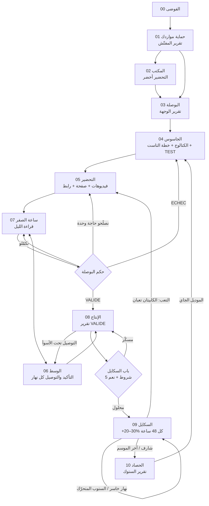

# قصة المسار: مراد والعباية MBF-M07

> المهمة: `course.curriculum` · J0001 · course-planner · مسودة 1 · 11/11/2026
> المراجع: `curriculum.md` (الجبهات 00–10) · السكيل `ecomanita-masar` (المراحل 0–9، الأبواب والتقارير) · `GLOSSARY.md` · ECOM MANITA (قراءة برك: `LIS-MOI-DABORD.txt` + الأجون الستة).
> **مراد** شخصية مخترعة، ماشي طالب حقيقي. الأرقام اللي في «الباب» جاية كاملين من المسار. حتى رقم مبيعات ما تقريه هنا، والقصة ما توعدش بحتى نتيجة.
> ⚠️ = افتراض، ولا فرق بين المسار وECOM MANITA لازم المالك يحسمو.

**شكون يدير واش (في الصناديق):**
`[هو]` مراد · `[المؤكّدة]` اللي تعيّط للزبونات · `[tassyir]` البوتيك والطلبيات والدراهم · `[الوكيل]` واحد من أجون ECOM MANITA (manager, editeur, page, testing, coach, scaling) ولا المكتب وبوت تيليغرام · `[المسار]` السكيل ecomanita-masar ومحرّك البوصلة · `[ميتا]` الإعلانات.
⚠️ واش الطالب يوصل للسكيل `ecomanita-masar` (البوصلة) ولا غير لـ«بوصلة التاجر» اللي في المكتب؟ القصة تفترض بلي يوصل للزوج.

---

## 00 · الفوضى (التمهيد)

مراد يبيع لبسة النسا من دارو. الكوموندات تجيه في الواتساب، يكتبهم في كراس، والستوك في راسو. كل ليلة يقول «اليوم بعت مليح»، وفي آخر الشهر الدراهم ما تبانش. الإشهار يشعل ويطفى بالإحساس. نهار شاف فيديو التمهيد، النحلة قالتلو: «رتّب الجبهة قبل ما تطلق الإشهار.»

> **📥 المدخول:** تاجر غارق: واتساب، كراس، إحساس.
> **⚙️ واش تدير المرحلة:** `[هو]` يتفرّج في التمهيد (00.1) وخريطة الدورة (00.2)، ويعرف بلي كل مرحلة عندها باب.
> **📤 واش يخرج:** قرار واحد: «نرتّب قبل ما نصرف».
> **🚪 الباب:** ما كاينش (مصوّر).
> **➡️ يروح لـ:** 01، بحساب tassyir.

---

## 01 · حماية مواردك (المرحلة 0: التجهيز والمفتّش)

مراد فتح حساب في tassyir ودخّل منتجاتو. المفتّش قرا الحساب وعطاه نقطة من 100 بحمرين: ما عندوش محافظ، ثمن الشراء 0 على نص المتغيّرات، وحتى مؤكّد ما راهو مسجّل. وزيد على هذا: 9 طلبيات مستنية من نهار الجمعة بلا اتصال. هذا نزيف، والإنقاذ يجي قبل الأسئلة. وفي الأسبوع الأول جاتو 3 طلبيات بنفس الرقم، وطلبية برقم فيه 5 أرقام برك. هنا فهم قاموس الحماية: **المكرّر والـ5 أرقام يروحو للسبام · الروبو والرافض يروحو لمشبوه (بطاقة صفرا) · المؤكّدة تعيّط قبل ما تأكّد.**

> **📥 المدخول:** حساب tassyir فيه البوتيك والمنتجات · شركة توصيل وعرضها (سعر الروتور) · ثمن الشراء لكل متغيّر · سعر الدولار تاعو · رقم البيكسل وتوكن CAPI.
> **⚙️ واش تدير المرحلة:**
> 1. `[المسار]` يقرا tassyir وحدو (قراءة برك) ويشوف واش الحساب ينزف: طلبيات فوق 48 ساعة بلا اتصال، رواجع ما تعالجتش، قبض 0 مسجّل، إعلان يصرف بلا ليد.
> 2. إذا ينزف: `[المسار]` يحسب النزيف بالدينار ويعطي «اليوم 3 حوايج برك».
> 3. `[المسار]` يدوّز **26 فحص** (أخضر 1، برتقالي 0.5، أحمر 0) ويعطي النقطة.
> 4. `[المسار]` يسقسي على اللي ما يتقراش: 4 محافظ، والدولار.
> 5. `[هو]` يصلّح بيدو اللي ما يكتبوش الوكيل: المحافظ، سعر الروتور، البيكسل وCAPI.
> 6. `[المسار]` يصلّح اللي يقدر يكتبو (SKU، الحالات، سبب الإلغاء المفروض) غير بعد «نعم»، ومن بعد يعاود يقرا.
> 7. `[tassyir]` يفرز: السبام، المشبوه، سلّم المكالمات، التوزيع على المؤكّدة الحاضرة.
> **📤 واش يخرج:** **تقرير المفتّش** (النقطة/100، الحمرين، الواجب الأول بـ4 أسطر) · حساب فيه: 4 محافظ، الدولار، شركة توصيل افتراضية، الروتور بالسعر اللي كتبو هو، ثمن الشراء لكل متغيّر، SKU بصيغة `متجر-موديل-لون-مقاس`، مؤكّد مسجّل، حالات وأسباب إلغاء، بيكسل + CAPI.
> **🚪 الباب:** تقرير المفتّش: **حتى أحمر وحتى مجهول**.
> **➡️ يروح لـ:** 02 (الحساب المحمي يتربط بالمكتب) و03 (الأرقام الحقيقية: الروتور، الشراء، الدولار تدخل للبوصلة).

---

## 02 · المكتب: فريقك يتركّب (أداة ECOM MANITA)

مراد نزّل الزيب، فتح Claude ← Code ← Local، ولصق الرسالة تاع `MESSAGE-A-COLLER-DANS-CLAUDE.txt`. Claude نصّب كلش، وهو كتب غير الموديباس وضغط «Autoriser». فتح المكتب على `localhost:4620`، ودخل لـ«التحضير». الخطوة الخامسة كانت «جرّب الدوبو» ومن بعد «ابعث فيديو تجربة لميتا». وصلت، والخطوات وحدة بوحدة ولاو خضر.

> **📥 المدخول:** PC (Windows ولا Mac) · اشتراك Claude Pro · حساب tassyir **من 01** · حساب إعلانات ميتا + صفحة · تيليغرام · 10 موسيقى على الأقل.
> **⚙️ واش تدير المرحلة:**
> 1. `[هو]` يلصق الرسالة في Claude (ولا يضغط `INSTALLER-WINDOWS.bat` / `INSTALLER-MAC.command`).
> 2. `[الوكيل]` ينصّب المكتب والأجون الستة ويكتب `_ETAT-INSTALLATION.txt`.
> 3. `[هو]` يكمّل «التحضير»: الولايات (ولايات الشمال برك، الكودات واجدين)، Cloudflare R2 بالمجان ولا التونال بلا حساب.
> 4. `[الوكيل]` يبعث فيديو تجربة لميتا. `[ميتا]` تديه، والعنوان يتسكّر.
> 5. `[هو]` يفتح «بوصلة التاجر» (لتحت في التحضير) ويشوف شحال لازمو.
> **📤 واش يخرج:** المكتب خدام · بوت تيليغرام مربوط · 6 أجون (`/ecom-manita:manager`، `editeur`، `page`، `testing`، `coach`، `scaling`) · الإعدادات (`config.local.json`: الدولار، المصاريف، النسب المصرّح بيها، الولايات).
> **🚪 الباب:** كل خطوات «التحضير» خضرا + فيديو التجربة وصل لميتا.
> **➡️ يروح لـ:** 03 (بوصلة التاجر) · 05 (editeur وpage) · 07 (testing) · 08–09 (coach وscaling).
> ⚠️ ECOM MANITA مازالت ماشي ثابتة كاملة (سؤال 2 في `curriculum.md`).

---

## 03 · البوصلة: الهدف قبل أول دينار (المرحلة 1)

قبل ما يختار حتى عباية، النحلة سقساتو: «شحال تحب ترجّع كاش، وفي شحال من يوم؟» مراد قال رقم كبير. البوصلة حسبت وقالت: بأرقامك ما يمشيش. عطاتو 4 طرق، ووراتو الرافعة اللي في يدو بلا رأس مال: السرعة في التأكيد. اختار هدف أصغر وقال «نعم».

> **📥 المدخول:** الأرقام الحقيقية **من 01** (الروتور، ثمن الشراء، الدولار، العمولة على الموصّلة، التغليف، وتيرة سحب شركة التوصيل) · رأس المال المتوفّر · السلعة: ورشة بعربون ولا جملة · هدف كاش + مدة، ولا «ما عنديش هدف».
> **⚙️ واش تدير المرحلة:**
> 1. `[المسار]` يسقسي سؤال واحد في المرة على اللي ما يتقراش.
> 2. `[المسار]` يحسب بـ`boussala guide`: رأس المال، الليدات في النهار، الفريق، ستوك البدء.
> 3. `[المسار]` يحسب بـ`boussala_commit` **الالتزام = أكبر هدف بحظ 9 من 10** + البوابات (شحال من طرد باش نقيسو التوصيل).
> 4. «بلا هدف»: `boussala_door` (capital) يعطي الوجهة الواقعية + 5 مؤشرات كل جمعة. الهدف ما يمشيش: `boussala_door` (gap) يعطي 4 طرق (وقت أكثر، رأس مال أكثر، هدف أصغر، الروافع).
> 5. `[هو]` يختار ويقول «نعم».
> **📤 واش يخرج:** **تقرير الوجهة** (الهدف، الالتزام 9/10، رأس المال، الليدات/يوم، الفريق، أقوى رافعة بلا دينار) · البوابات اللي تخدم من بعد.
> **🚪 الباب:** هدف مكتوب (ولا «بلا هدف» + الوجهة) + «نعم».
> **➡️ يروح لـ:** 04 (الالتزام يقول شحال من موديل وبأي رأس مال) · 07 (البوابات تعطي حدود التاست) · 08 (البوابة 1: شحال من طرد قبل الإنتاج).
> ⚠️ المسار «متفائل في البداية»: يحسب الليدات كاملين من أول نهار، وفي الواقع نطلعو بالتدرّج.

---

## 04 · الجاسوس: البحث والفلترة (المراحل 2 + 3)

مراد كان يختار بالعين: «هادي شابة». دروك الجاسوس يقرا مكتبة إعلانات ميتا. لقى صفحة جزائرية لانصات عباية كتان صيفية بموجة صغيرة، سكتت 6 أيام، ومن بعد رجعت بإعلانات أكثر **لنفس العباية**. هادي الدرجة 1: «بلا ستوك، خلّص الإنتاج». ولقى نفس الموديل يدور في المغرب قبل. العباية خذات بطاقة ورقم: **MBF-M07**. وفي الفلترة، 2 مرشّحين «شابين» طاحو في أقصى ليد، وطاحو.

> **📥 المدخول:** تقرير الوجهة **من 03** · كونيكتور ميتا وحساب إعلانات نشيط · سعر الورشة لكل مرشّح (سؤال) · سعر البيع المتوقّع · التأكيد والتوصيل والليد تاعو من tassyir (الملابس بلا تاريخ = **الأسوأ**).
> **⚙️ واش تدير المرحلة:**
> 1. `[المسار]` (الجاسوس) يبحث في `ads_library_search`: كلمة وحدة × `DZ` × `ACTIVE`، ومن بعد التاريخ (`ALL`) للصفحات المهمّة: الموجات والفراغات.
> 2. `[المسار]` يحكم بـ**الدرجات التسعة** (ماشي بالعين)، ويقرا السبق: `MA` قبل `DZ`.
> 3. `[المسار]` يكتب بطاقة لكل موديل (الرقم، الصفحة، أول ظهور، الدفعات، الزوايا، السعر إذا مكتوب، `SRC-…`)، **حتى المرفوضين**.
> 4. `[المسار]` يفلتر بـ`boussala_pick`: 6 معايير من 0 لـ2 (إثبات السوق ×2، المارج، الموسم، خطر المقاس، الطرز، التمايز) ويقول شحال من موديل يلزم باش نخرجو بـ**2 رابحين بحظ 80%**.
> 5. `[المسار]` يحسب لكل مرشّح: الصافي، **أقصى ليد (الأسوأ)**، هامش الأمان. اللي يطيح في أقصى ليد يطيح.
> 6. `[هو]` يكتب الأيام والميزانية. `[المسار]` يوصي (`boussala_testweek` plan): **~50 حدث في 7 أيام لكل مجموعة إعلانات**. السقف = الربح على المؤكّدة قبل الإعلان · أقصى ليد = السقف × التأكيد · الستوب = ليدات التعلّم × أقصى ليد · إعلان بلا ليد في 24 ساعة يتحبس.
> 7. `[هو]` يقول «نعم». `[tassyir]` المنتج يتخلق ويتحطلو التاغ `TEST`.
> **📤 واش يخرج:** **كتالوج الأسبوع** (~20 مرشّح، 🟢🟡⚪، المرفوضين مسجّلين) · **خطة التاست** (لكل موديل: الصافي، أقصى ليد، الستوب، الميزانية/يوم، الأيام، رافعة القطعتين) · المنتج MBF-M07 في tassyir بتاغ `TEST`.
> **🚪 الباب:** موديلات فاتو المحرّك + خطة مكتوبة (الحدود، الميزانية، الأيام) + «نعم» ← تاغ `TEST`.
> **➡️ يروح لـ:** 05 (البطاقة MBF-M07 والزوايا تروح للبريف) · 07 (الستوب، أقصى ليد، الميزانية تروح لحملة التاست).
> ⚠️ المكتب يعطي للموديل كود تاعو (`MAN01`، `MAN02`…)، والجاسوس يعطي `MBF-M07`. لازم نقرّرو كيفاش يتربطو (الاسم ولا الكود).

---

## 05 · التحضير: الكرياتيف والصفحة (المرحلة 4)

الكابيتان يتصنع هنا. مراد صوّر العباية على مانكان في الدار بلونين، بيج وكاكي. الجاسوس قال بلي البيج يبيع أكثر في السوق، لهذا البيج يبان أولاً. بعث لينك الدرايف للروبو في تيليغرام. المكتب فرز، والمونتاجور خرّج الفيديوهات بالفيشة تاع كل واحد. وفي الصفحة ما حطّش «كمية محدودة» ولا آراء مخترعة.

> **📥 المدخول:** بطاقة MBF-M07 والزوايا **من 04** · خطة التاست **من 04** · لينك درايف مفتوح فيه الرشّات (و10 موسيقى) **عبر المكتب من 02** · البيكسل + CAPI أخضر **من 01** · سعر البيع (بين 1,500 و59,000 دج، حد أداة الصفحة) · الستوك (ولا «تاست بلا سلعة»).
> **⚙️ واش تدير المرحلة:**
> 1. `[هو]` البريف: شحال من لون (اللون اللي يبان أولاً = اللي يبيع أكثر)، المانكان، البلاصة، **من 1 حتى 4 فيديوهات للتاست**.
> 2. `[هو]` يبعث اللينك للروبو. `[الوكيل]` (editeur) يهبّط، يفرز الموديلات (كل موديل يتأكّد على تصويرتو «صحيح»)، يسقسي على اسم كل لون، يمونتي، ويشوف كل فيديو قبل ما يسلّم.
> 3. `[الوكيل]` يعمّر **الفيشة** تاع كل فيديو بقوائم مسكّرة: الرقم، المانكان، اللون الأول، نوع الهوك، أول ثانيتين، الزاوية، البلاصة، الشكل، العرض، المدة، الموسيقى. **متغيّر واحد** بين الفيديوهات.
> 4. `[الوكيل]` (page) يحضّر الصفحة في tassyir: الوصف = القطعة برك، أول لون = الصورة الأولى، صورة لكل لون، عرض قطعة / قطعتين، SKU، الستوك، التغليف. ويوري الملخّص.
> 5. `[هو]` يقرا الملخّص ويقول «نعم» ← الصفحة تتنشر.
> 6. `[المسار]` يحضّر الرابط المخفي (`lienSuivi`).
> **📤 واش يخرج:** `_rapport-editeur.md` + الفيديوهات `variante_XX.mp4` + الصور `photos/couleur-N` (6 على الأقل) + الفيشات · صفحة MBF-M07 منشورة + `lien-page.txt` · الرابط المخفي · **تقرير جاهزية الإطلاق**.
> **🚪 الباب:** الفيديوهات جاهزين، كل واحد بفيشتو كاملة · الصفحة منشورة والعرض واجد · البيكسل + CAPI أخضر · الرابط المخفي محضّر.
> **➡️ يروح لـ:** 07 (الفيديوهات + الصفحة + الرابط = حملة التاست) · 07.4 (الفيشات تروح لمكتبة الكرياتيف).
> ⚠️ **فرق 1:** المسار يقول «الصفحة مسودة والتاجر هو اللي ينشر». ECOM MANITA (قانون البائع 06/10/2026) تنشرها ديراكت بعد ما يقرا التاجر الملخّص ويقول «نعم». في القصة: «نعم» على الملخّص = النشر بيد التاجر.
> ⚠️ **فرق 2:** المسار: 1–4 فيديوهات للتاست. editeur يمونتي حتى 10 متغيّرات، وtesting يدّي حتى 6 حسب الميزانية. لازم نقولو للطالب واش يدّي للتاست.

---

## 06 · الوسط: التأكيد والتوصيل (المرحلة 6، كل نهار من أول طلبية)

القصة هنا تبدا قبل الإطلاق: مراد ركّب الوسط قبل ما يشعل الإعلان. أول طلبية جات على 21:40. المؤكّدة كانت محضّرة: وردية ليل، ولا أول مكالمة 09:00. الطلبية الثانية جات على 14:05، والمكالمة الأولى خرجت على 14:31، يعني تحت الـ**30 دقيقة**. سكريبت التاست يمشي بترتيب: الموديل واللون، المقاس، **المدة قبل السعر**. وكي زبونة طلبت لمسة، تكتبت في التعليق `#L-`. طرد رجع من ولاية بعيدة، والسبب تكتب `#R-01` (ما جاوبش). بعد 3 رواجع من نفس الولاية، مراد بدّل للمكتب بلاصة الدار.

> **📥 المدخول:** المؤكّد والتوزيع والحالات وأسباب الإلغاء **من 01** · السكريبتات (التاست، القطعتين، الزبون اللي رجّع، الولايات الصعيبة) يكتبهم مراد بيدو · أول طلبيات **من 07**.
> **⚙️ واش تدير المرحلة:**
> 1. `[tassyir]` يوزّع الطلبية على مؤكّدة حاضرة. الاسترجاع بعد 30 دقيقة.
> 2. `[المؤكّدة]` تعيّط في **30 دقيقة**، تدوّز السلّم كامل (APPEL × JOUR)، تقترح القطعتين في كل مكالمة، وتأكّد العنوان كي تكون الزبونة رجّعت قبل (`returnedCount`).
> 3. `[المؤكّدة]` ما تلغي حتى طلبية بلا سبب. التأكيد في التاست = طلبية مؤكّدة بتاريخ (`schedule_order` كي الورشة تطوّل).
> 4. `[هو]` يبعث نفس النهار. `[tassyir]` يتبّع الطرد حتى الكاش ويسجّل القبض.
> 5. `[المسار]` يقرا ويقترح سبب روتور «مرجّح» `#R-01…10`. `[المؤكّدة]` تأكّدو مع شركة التوصيل. التبديل ماشي روتور.
> 6. `[المسار]` ما يأكّد وما يلغي حتى طلبية بلا «نعم».
> **📤 واش يخرج:** **تقرير التأكيد 22:00** (الطلبيات، المؤكّدة %، أول مكالمة، بلا سبب، فوق 48 ساعة، حسب المتغيّر، القطعتين) · **تقرير التوصيل** (المبعوثة، الموصّلة، الروتور % بأسبابو، الحابسة، الموصّل ماشي مخلّص، أصعب ولايات) · طلبيات مؤكّدة بالمصدر، وطرود بأسبابها.
> **🚪 الباب:** أول اتصال في **30 دقيقة** · **0** إلغاء بلا سبب · **0** طلبية مفتوحة فوق **48 ساعة** · 0 رواجع ما تعالجتش · مؤكّدة ما تبعثتش فوق 48 ساعة = إنذار.
> **➡️ يروح لـ:** 07 (المؤكّدة هي اللي يحكم بيها التاست، ماشي البيكسل) · 08 (الموصّلة وأسباب الروتور هوما معيار VALIDE) · كل الجبهات من بعد (التأكيد يخدم كل نهار).
> قاموس الماتش: **الوسط** = التأكيد · **المهاجم** = التوصيل. «مؤكّد وما وصلش = خسارة مزدوجة.»

---

## 07 · ساعة الصفر: التاست (المرحلة 5)

الحملة تخلقت **واقفة**. ليلة كاملة قعد مراد يشوفها في ميتا ويدّو على الزر. كتب «لانسي» وراح يرقد. الليلة الأولى قراءة الليل جاتو حمرا: إعلان واحد بلا الرابط المخفي. «أحمر = ما نحكموش». صلّحو. الليلة الثانية خضرا: الفيديو V02 (هوك «شوفي قبل ما تخلّصي») يجيب مؤكّدة بثمن تحت السقف. الفيديو V04 ما جاب حتى ليد في 24 ساعة، وتوقّف وحدو. البوصلة ما حكمتش في «اليوم 3». حكمت كي الأرقام كفات وميتا خرجت من التعلّم: **VALIDE**. الكابيتان هو V02.

> **📥 المدخول:** الفيديوهات + الفيشات + الصفحة + الرابط المخفي **من 05** · خطة التاست (الستوب، أقصى ليد، الميزانية) **من 04** · الوسط راهو يخدم **من 06** · تاغ `TEST`.
> **⚙️ واش تدير المرحلة:**
> 1. `[الوكيل]` (testing) يحسب البريك إيفن ويقرا البيكسل. **حملة وحدة = موديل واحد**. الهيكل (`structureTest`): نصيب الفيديو ≥ 15 × أقصى ليد ÷ 3 أيام ← **ABO** · من **3$** حتى هاذ الحد ← **CBO** · تحت 3$ ← فيديوهات أقل.
> 2. `[الوكيل]` يسمّي: `التاريخ | TESTING | السعر | الموديل | الميزانية | المفتاح`، يحط الرابط المخفي (`utm_campaign={{campaign.id}}&utm_content={{ad.id}}`) في **كل** إعلان، ويستهدف ولايات الشمال (25).
> 3. `[ميتا]` كلش يتخلق **واقف**. `[هو]` يكتب **«لانسي»**. حتى دينار قبلها.
> 4. كل ليلة `[الوكيل]` يدوّز **4 فحوص** قبل أي حكم: إعلان بلا رابط (1 = 🔴) · الأقواس ما تبدّلوش (1 = 🔴) · صرف ميتا ≠ tassyir فوق **5%** (🔴) · طلبيات بلا مصدر فوق **10%** (🟡) · البيكسل ما يطابقش (🟡).
> 5. `[الوكيل]` يوقّف بلا «نعم»: إعلان بلا ليد في **24 ساعة**، ولا الموديل لمس الستوب.
> 6. `[المسار]` يحكم (`boussala_testweek` decide، ثقة **90%**) على **المؤكّدة**: **VALIDE** (حتى أسوأ حالة رابحة بالتوصيل الأسوأ + ميتا خرجت من التعلّم ≈ 50 حدث لكل مجموعة) · **ECHEC-ADS / ECHEC-CONF** (حتى أحسن حالة خاسرة) · **نصلّحو حاجة وحدة** (التأكيد تحت الأدنى والموديل رابح) · **نكمّلو** · **RESERVE**.
> 7. `[المسار]` يعمّر **مكتبة الكرياتيف**: تحت **15 ليد** = «ما تقاستش» · وسم يولّي قاعدة من **5 فيديوهات مقاسة** · دفعة جديدة كل أسبوع، متغيّر واحد.
> 8. `[هو]` يقول «نعم» على التاغ.
> **📤 واش يخرج:** حملة `| TESTING | … | MBF-M07 |` + `test-en-cours.json` · **قراءة الليل** كل ليلة · **حكم التاست** · مكتبة الكرياتيف · التاغ الجديد (`VALIDE` / `ECHEC-…` / `RESERVE`).
> **🚪 الباب:** حكم البوصلة: VALIDE / نصلّحو حاجة / ECHEC.
> **➡️ يروح لـ:** VALIDE ← 08 (الكابيتان + المؤكّدة حسب اللون × المقاس) · نصلّحو ← 05 · ECHEC ← 04 (الموديل الجاي من الكتالوج).
> قاموس الماتش: **الميديا باير** يبدا اللعب · **الكابيتان (C)** = الكرياتيف الرابح · «الليد للتوقيف، المؤكّدة للحكم.»
> ⚠️ **فرق 3:** ECOM MANITA تحكم في **اليوم 3** (قانون البائع). المسار يقول «ما كاينش اليوم 3 ثابت». والكوتش نفسو يقول بلي ليلة اليوم 3 ما طاحتش غير ~57.5% من المؤكّدات.
> ⚠️ **فرق 4:** المسار: «الستوب» = حد على الموديل. ECOM MANITA: **بلا حتى plafond** في ميتا، غير ميزانية النهار، والتوقيف يجي من القراءة (disjoncteur). وأقل مجموعة: **3$** في المسار مقابل **7$** (فيديو ولا زوج) / **5$** (أكثر) في testing.

---

## 08 · VALIDE: الإنتاج وأول الطرود (المرحلة 7)

ميتا قالت VALIDE، بصح مراد ما خيّطش 300 قطعة. الكوتش حسب: قبل أي عربون لازم **35 مؤكّدة** (عندو مرجعين برك). قسّم الطلبية حسب آخر 5 أيام: البيج في المقاس M خذا أكبر حصة، ماشي بالتساوي. خلّص عربون 30% للورشة، والإعلان رجع يشعل نهار قبل ما تجي السلعة. أول الطرود راحو لزبونات التاست، هوما أول المشترين.

> **📥 المدخول:** حكم VALIDE + تاغ `VALIDE` **من 07** · المؤكّدة حسب اللون × المقاس **من 06** · البوابة 1 (شحال من طرد لقياس التوصيل) **من 03** · قوانين الورشة تاعو.
> **⚙️ واش تدير المرحلة:**
> 1. `[المسار]` بوابة الإنتاج (`boussala_commit`، البوابة 1). `[الوكيل]` (coach) يشوف المؤكّدة: **35** إذا أقل من 3 مراجع · **50** إذا 3 ولا أكثر.
> 2. `[الوكيل]` (coach) يخرّج **bon de commande** مقسوم حسب آخر **5 أيام** (`repartitionCommande`). `[هو]` يقرّر الكمية. الوكيل ما يكلّمش الورشة.
> 3. `[هو]` والورشة ⚠️ (قوانين التاجر): **30–50 قطعة** للدفعة على الأقل · عربون **30%** · التسليم كل يومين إذا يقدر · الإعلان يبدا **نهار قبل الاستلام**.
> 4. `[المؤكّدة]` تعيّط لزبونات التاست. `[هو]` يبعث نهار تجي السلعة.
> 5. `[الوكيل]` (coach) يقرا النسب الحقيقية وROAS **على الموصّلة**. `[المسار]` يحسب ثمن الطرد الموصّل ويقراه مع أسباب الروتور.
> **📤 واش يخرج:** bon de commande مقسوم · دفعة إنتاج · أول الطرود الموصّلة · **تقرير VALIDE** (الموصّلة من البوابة، ثمن الموصّلة مقابل السقف، التوصيل % مقابل الأسوأ، الورشة، التقسيم) · سبب لكل روتور.
> **🚪 الباب:** ثمن الطرد **الموصّل** تحت السقف + سبب لكل روتور. إذا التوصيل تحت الأسوأ: ما نكبّروش، نرجعو للوسط (06).
> **➡️ يروح لـ:** 09 (الربح الحقيقي على الموصّل + الستوك + الكاش اللي رجع = بطاقة المرحلة الثانية) · 06 إذا التوصيل ضعيف.
> قاموس الماتش: **المرمى** = الربح على الموصّل. «البوصلة تحكم على اللي يدخل للشباك، ماشي على اللي يسدد.»

---

## 09 · السكايل (المرحلة 8)

مراد حب يضرب الميزانية ×3 من نهار. البطاقة قالتلو لا: +25% برك، وبعد نهار خاسر ما نزيدوش. الكابيتان V02 تنسخ بنفس رقم البوست لحملة SCALE، وحملة التاست بقات مفتوحة. بعد شوية، شريط الطاقة طاح: ثمن المؤكّدة على 3 أيام طلع أكثر من 25% على أحسن 3 أيام. الكابيتان **تعبان**. البوصلة قالت «تجديد»، لأن الموديل مازال يربح. الموتنير كان يحضّر البديل في منطقة التاست: دفعة الجمعة فيها هوك جديد. وكي المؤكّدة وصلت ~30 مؤكّدة في النهار، دخلت مؤكّدة ثانية.

> **📥 المدخول:** تقرير VALIDE والربح على الموصّل **من 08** · الستوك والورشة · الكاش اللي رجع · مكتبة الكرياتيف (الكابيتان + الاحتياط) **من 07** · `test-en-cours.json` + الكوتش قال «الباب محلول».
> **⚙️ واش تدير المرحلة:**
> 1. `[المسار]` باب السكايل (`porteScale` + البوصلة): (0) الفحوص الأربعة خضرا · (1) الربح الحقيقي على الموصّل **> 0** على دفعة كمّلت دورتها · (2) المنحنى ماشي تحت الأسوأ (`boussala_range` 🟢/🟡) · (3) الستوك يغطي والورشة تلحق · (4) الكاش يغطي الخطوة والاحتياط ما يتمسّش · (5) «نعم».
> 2. `[الوكيل]` (coach) يدوّز 5 فحوص: التأكيد ≥ نص الطلبيات · التوصيل: «au moins deux colis expédiés sur cinq» ⚠️ (النص ما يوضّحش 2 من 5 تاع واش) · **20** طرد موصّل على الأقل · الموصّل أرخص من البريك إيفن · كاين ستوك. «لا» وحدة تسكّر.
> 3. `[الوكيل]` (scaling) يخلق حملة **SCALE** (CBO، 1–3 مجموعات broad، 25 ولاية) بالكابيتان **بنفس POST ID**، **واقفة**. `[هو]` «لانسي».
> 4. `[هو]` يكتب **«طلّع»** لكل زيادة: **+20–30% كل 48 ساعة**، تحت السقف الأسوأ، **أبداً بعد نهار خاسر**. الستوب المتحرّك: ربح الطرد على 3 أيام يطيح ← ننقصو.
> 5. `[المسار]` يراقب التعب: ثمن المؤكّدة 3 أيام **+25%** على أحسن 3 أيام، ولا الليد فوق أقصى ليد يومين ← إنذار · ثمن الموصّل 3 أيام فوق السقف ← تأكيد ← **تجديد** ولا **خروج**.
> 6. `[المسار]` يقرا الأحداث (`boussala_events`، 7 أيام مقابل 21): كرياتيف مات، منافس دخل، منتج شارف.
> 7. `[هو]` يكبّر الفريق: مؤكّدة ثانية فوق **~30 مؤكّدة/نهار**. الجماهير تتجرّب هنا (~50 ليد لكل جمهور).
> **📤 واش يخرج:** **بطاقة المرحلة الثانية** (الربح على الطرد، التوصيل، أكبر سبب روتور، الستوك/أيام، الكاش، الشروط، الخطوة الأولى) · تاغ `SCALE` · حملة SCALE · `scaling-en-cours.json` · إنذارات التعب · الخليفة محضّر.
> **🚪 الباب (باش تكمّل تكبّر):** الشروط الـ5 + «نعم» على البطاقة، وتتعاود قبل كل خطوة.
> **➡️ يروح لـ:** التعب ← 05/07 (تجديد الكرياتيف في حملة التاست) · «شارف» ولا الموسم يكمّل ← 10.
> قاموس الماتش: **شريط الطاقة** = تعب الكرياتيف · **تعبان** = لازم يتبدل · **الموتنير** يحضّر البديل · **الاحتياط** = زوج إعلانات ديما.

---

## 10 · الحصاد والتصفية (المرحلة 9)

آخر الصيف. مراد كان ناوي يعاود دفعة ثالثة. تقرير الستوك وقّفو: التغطية فاتت 30 يوم، يعني ممنوع إنتاج جديد. الكاكي M خلاص، والمؤكّدة ولات توجّه الزبونات للبيج M. وكي فاتت التغطية 45 يوم في الكاكي L، بدات التصفية بالتدريج: عرض القطعتين. الإعلان نقص مع الستوك اللي بقى، وتحبس قبل ما تجي طلبيات بلا سلعة. فهم مراد: «الربح المحبوس ماشي ربح». وفي نفس الجمعة، موديل جديد من الكتالوج كان داخل للتاست.

> **📥 المدخول:** الستوك من tassyir (`get_inventory`، ولا Sellable) · الموصّلة/نهار آخر 14 يوم **من 06/09** · مدة الورشة · تاريخ نهاية الموسم · تاغ `SCALE` ولا إشارة «شارف» **من 09**.
> **⚙️ واش تدير المرحلة:**
> 1. `[المسار]` يحسب **الستوك المتاح** = `totalItems − delivered − inTransit − damaged` بثمن الشراء.
> 2. `[المسار]` يحسب أيام التغطية = الستوك ÷ الموصّلة/نهار: فوق **30** = ممنوع إنتاج · فوق **45** = تصفية (القطعتين، سعر أقل، لون مع لون).
> 3. `[المسار]` يحسب نقطة إعادة الطلب = السرعة × (مدة الورشة + **3 أيام**)، وآخر طلبية للورشة قبل نهاية الموسم بـ**~8 أيام** (`derniereCommande`).
> 4. `[هو]` يقول «نعم» على التاغ `DESTOCK`. `[ميتا]` الإعلان ينقص مع الستوك ويتحبس قبل ما يخلاص.
> 5. `[المؤكّدة]` توجّه للمتغيّر المتوفّر ولا لموديل آخر فيه نفس المتغيّر (سكريبت التصفية).
> 6. `[المسار]` كل **أحد**: الميزانية تخرج من الموديل اللي يطيح وتدخل للي يطلع.
> **📤 واش يخرج:** **تقرير الستوك** بـ3 أسطر (الستوك بثمن الشراء · أيام التغطية · الكاش الصافي) + نقطة إعادة الطلب + آخر طلبية · تاغ `DESTOCK` · كاش رجع للمحفظة.
> **🚪 الباب:** الستوك يخلاص، الكاش يرجع.
> **➡️ يروح لـ:** الموديل الجاي (04 ولا الاحتياط من الكتالوج). المحفظة ديما: **1 في التاست · 2–3 في السكايل والحصاد · 1 احتياط**.
> السطر اللي يبقى: «نجاحك ما يكونش صدفة.»

---

## السلسلة في صفحة وحدة

| # | المرحلة | المدخول | واش تدير (سطر) | واش يخرج | الباب | يروح لـ |
|---|---|---|---|---|---|---|
| 00 | الفوضى | واتساب + كراس | يفهم علاش التنظيم قبل الإشهار | قرار «نرتّب قبل ما نصرف» | — | 01 |
| 01 | حماية مواردك (0) | قرار 00 + حساب tassyir + الأرقام الخام | المفتّش: 26 فحص، الإنقاذ، واجب واحد في المرة | **تقرير المفتّش** + حساب محمي | 0 أحمر، 0 مجهول | 02، 03 |
| 02 | المكتب | **حساب محمي من 01** + PC، Claude Pro، ميتا، تيليغرام، 10 موسيقى | تنصيب + «التحضير» + فيديو تجربة | المكتب + البوت + 6 أجون + الإعدادات | التحضير أخضر + فيديو وصل لميتا | 03، 05، 07 |
| 03 | البوصلة (1) | **الأرقام الحقيقية من 01** + رأس المال + الهدف | guide + commit (9/10) ولا door | **تقرير الوجهة** + البوابات | هدف مكتوب + «نعم» | 04، 07، 08 |
| 04 | الجاسوس (2+3) | **تقرير الوجهة من 03** + ميتا + سعر الورشة | الدرجات التسعة، pick، أقصى ليد، testweek | **كتالوج الأسبوع** + **خطة التاست** + تاغ `TEST` | فاتو المحرّك + خطة + «نعم» | 05، 07 |
| 05 | التحضير (4) | **بطاقة MBF-M07 + الخطة من 04** + الدرايف عبر **المكتب (02)** | البريف، editeur، الفيشة، page، الرابط المخفي | فيديوهات بفيشة + صفحة منشورة + رابط + **جاهزية الإطلاق** | الباب الرباعي تاع التحضير | 07 |
| 06 | الوسط (6) | **المؤكّد والحالات من 01** + **الطلبيات من 07** | 30 دقيقة، السلّم، السكريبت، التتبّع حتى الكاش، #R | **تقرير التأكيد 22:00** + **التوصيل** | 30 د · 0 بلا سبب · 0 فوق 48س | 07، 08 |
| 07 | ساعة الصفر (5) | **الفيديوهات + الصفحة من 05** + **الخطة من 04** + **الوسط من 06** | حملة واقفة ← «لانسي» ← 4 فحوص كل ليلة ← حكم | **قراءة الليل** + **حكم التاست** + مكتبة الكرياتيف | VALIDE / نصلّحو / ECHEC | 08 ولا 05 ولا 04 |
| 08 | VALIDE (7) | **حكم VALIDE من 07** + **المؤكّدة لون×مقاس من 06** + البوابة 1 **من 03** | بوابة الإنتاج، التقسيم 5 أيام، الورشة، أول الطرود | **تقرير VALIDE** + أسباب الروتور | الموصّل تحت السقف + سبب لكل روتور | 09 (ولا 06) |
| 09 | السكايل (8) | **تقرير VALIDE من 08** + الستوك + الكاش + **الكابيتان من 07** | الباب، SCALE بنفس POST ID، +20–30%/48س بـ«طلّع»، التعب | **بطاقة المرحلة الثانية** + تاغ `SCALE` | 5 شروط + «نعم» | 10 (ولا 05/07 للتجديد) |
| 10 | الحصاد (9) | **SCALE / «شارف» من 09** + الستوك + الموصّلة/نهار | الستوك المتاح، التغطية 30/45، آخر طلبية، تصفية | **تقرير الستوك** + `DESTOCK` + الكاش | الستوك يخلاص، الكاش يرجع | 04 (الموديل الجاي) |

---

## الحلقات

---

## الافتراضات والفروق (⚠️) اللي لازم المالك يحسمها
1. هل الطالب يوصل للسكيل `ecomanita-masar` (البوصلة)، ولا غير لـ«بوصلة التاجر» اللي في المكتب؟
2. النشر: المسار يقول «التاجر ينشر»، وECOM MANITA تنشر ديراكت بعد «نعم» على الملخّص.
3. عدد فيديوهات التاست: 1–4 في المسار، وحتى 6 في testing (من 10 متغيّرات).
4. نهار الحكم: «حتى يوم ثابت» في المسار، و«اليوم 3» في ECOM MANITA.
5. الستوب وأقل مجموعة: حد على الموديل و3$ في المسار، و«بلا plafond» و7$/5$ في ECOM MANITA.
6. كود الموديل: `MBF-M07` (الجاسوس) مقابل `MAN0x` (المكتب).
7. قوانين الورشة (30–50 قطعة، 30%، نهار قبل الاستلام) هي قوانين التاجر، لازم تتأكّد.
8. الأوقات اللي في القصة (21:40، 14:31…) ورموز الفيديوهات (V02، V04) أمثلة للقصة، ماشي أرقام مقاسة.
